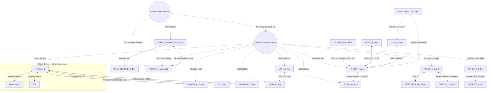

# Sensor Cross-Validation Matrix

This document outlines how sensors on the mast are mathematically compared *against each other* (excluding checks against theoretical external models like clear-sky irradiance).

## 1. Atmospheric & Thermodynamic Clustering
- **`AirTemp_C` ↔ `DewPoint_C` ↔ `RH`**: These three variables are measured/calculated by the exact same physical sensor. This check acts as an *internal consistency validation* of the sensor's own firmware/datalogger algorithm, ensuring the reported dewpoint perfectly matches the Magnus-Tetens derivation of its own Air Temp and RH.
- **`AirTemp_C` ↔ `TargetTemp_C_Avg`**: The ambient air temperature is compared against the surface target temperature to calculate the Sensible Heat Flux gradient.
- **`AirTemp_C` ↔ `T_nr_Avg` & `BodyTemp_C_Avg`**: The internal body thermistors of the radiation sensors are checked against ambient air temperature. A deviation >15°C indicates intense anomalous heating or a broken thermistor.

## 2. Radiometric Redundancy & Theoretical Bounds
- **`PVGIS Clear Sky` → `SW_rad_Avg` / `R_SW_in_Avg`**: Before any internal consistency checks, the incoming shortwave radiation is bounded by the theoretical maximum clear-sky irradiance (simulated by pvlib/PVGIS) for that exact latitude, longitude, and timestamp.
- **`SW_rad_Avg` ↔ `R_SW_in_Avg`**: Two different shortwave radiation sensors are checked against each other to ensure they are within 50 W/m².
- **`LW_rad_Avg` ↔ `R_LW_in_Avg`**: Two different longwave radiation sensors are cross-checked for consistency.
- **`PPFD_IN_Avg` ↔ `R_SW_in_Avg`**: The PAR (Photosynthetically Active Radiation) sensor is checked against the broadband pyranometer to ensure PAR remains a physically possible fraction of total shortwave energy (~45%).
- **`R_SW_in_Avg` ↔ `R_SW_out_Avg`**: Incoming versus outgoing shortwave radiation is compared to ensure surface Albedo remains within realistic boundaries (0.05 - 0.95).

## 3. Hydrological & Soil Thermal Coupling
- **`RainE_Standard_Precip_Tot` ↔ `TDR310_x_avg_VWC`**: The rain gauge at the top of the mast is coupled with the soil moisture sensors underground. The pipeline flags deep soil moisture spikes that occur without sufficient, time-lagged precipitation from the rain gauge.
- **`RainE_Standard_Precip_Tot` ↔ `RainE_Standard_Int_1m`**: The cumulative rain gauge metric is checked against the rain intensity metric.
- **`TDR310_x_avg_T` ↔ `TEROS22_x_avg_Temp`**: Redundant soil temperature sensors co-located at the same depth are validated against each other (flagged if diff > 2°C).
- **`G_PLATE_1_1_1` ↔ `G_PLATE_1_1_2`**: Redundant Soil Heat Flux plates are checked for spatial consistency.

## 4. Full Surface Energy Balance Closure
- **`R_n` - `G` - `H`**: The ultimate physical constraint connecting all three domains. The net radiation ($R_{SW,in} - R_{SW,out} + R_{LW,in} - R_{LW,out}$) is compared against the soil heat flux ($G$) and sensible heat (derived from `AirTemp_C` and `TargetTemp_C`). Without a latent heat sensor, the residual ($R_n - G - H$) should not drop significantly below zero, otherwise it implies energy creation.
- **TDR sensors provide Soil Heat Storage ($S_{soil}$)**: The true surface Soil Heat Flux ($G$) is actually the sum of the heat flux plate (`G_PLATE_1_1_1`) PLUS the heat storage in the soil *above* the plate. This storage is calculated directly using the TDR soil moisture (`TDR310_1_avg_VWC`) and temperature (`TDR310_1_avg_T`). This physically anchors the TDR soil sensors to the Energy Balance.
- **The Evapotranspiration ($LE$) Link**: The Energy Balance residual ($R_n - G - H$) is physically equal to Latent Heat ($LE$), which is Evapotranspiration. Evapotranspiration is the primary driver of soil moisture depletion (`TDR310_x_avg_VWC`) between precipitation events. Thus, the Water Balance ($P - ET = \Delta S$) and the Energy Balance are inextricably linked through the TDR sensors.
